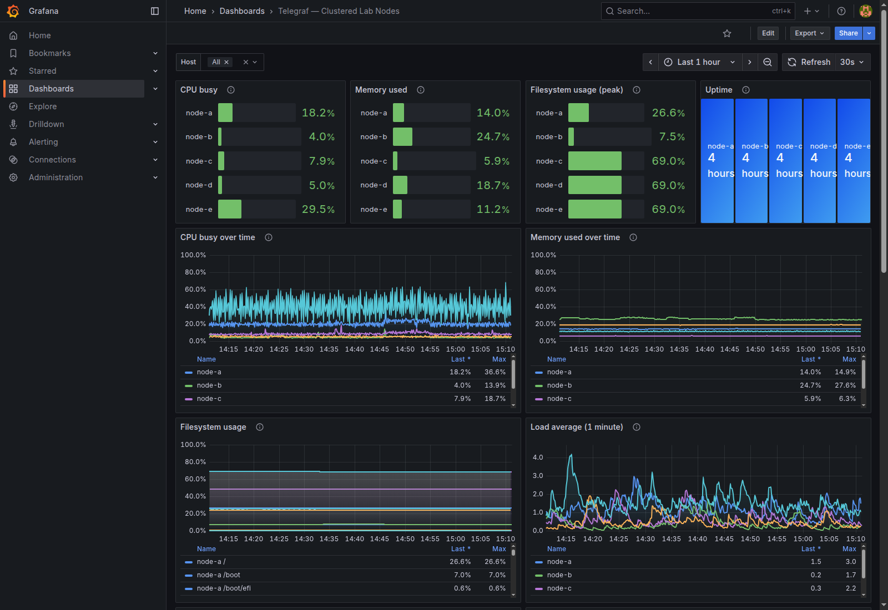
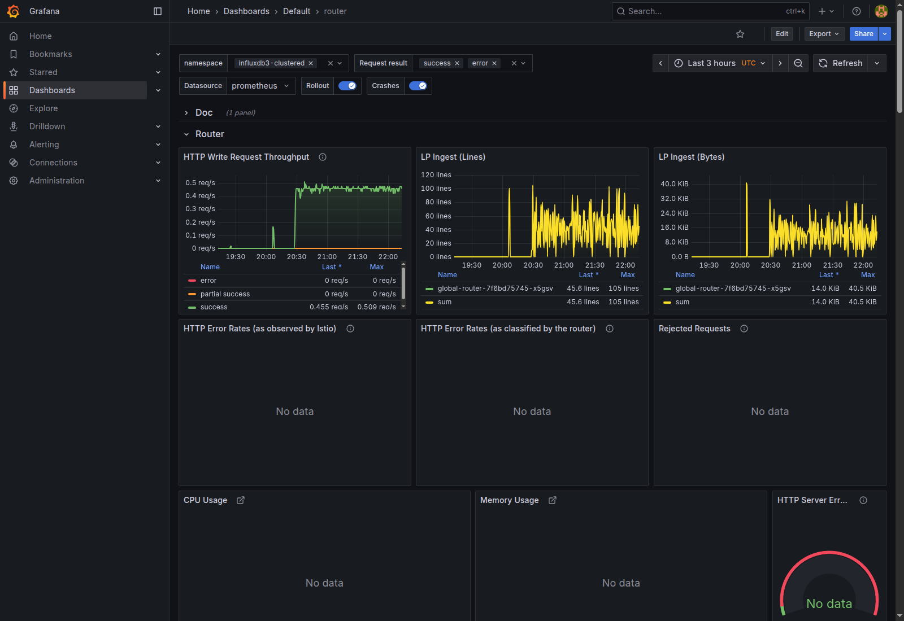

# InfluxDB Clustered: a small Kubernetes lab

A practical, unofficial lab guide for running **distributed InfluxDB Clustered**
with **persistent SeaweedFS S3**, PostgreSQL, Grafana and all-node Telegraf metrics.
This is not the standalone InfluxDB 3 Enterprise server, and it is not a
production sizing, high-availability or backup design.

**New to InfluxData or Clustered? [Start here](docs/start-here.md).** It explains
what we are building, why both PostgreSQL and SeaweedFS are needed, how the two
kinds of Grafana dashboards differ, and the terminology used in the commands.
You can read the concepts without product experience; installation assumes an
existing Kubernetes cluster and some comfort with a Linux terminal.



> The screenshots are real browser captures from the working lab, not mockups.
> Host labels in the Telegraf screenshot were anonymized to `node-a`–`node-e`;
> metric values were not altered. No credentials, license or registry material
> are distributed in this repository.

## What this lab demonstrates

- A distributed Clustered deployment using reduced lab resource requests.
- Three catalog peers retained on compatible nodes, rather than reducing a
  configured peer/quorum topology to one node.
- A PostgreSQL catalog on a persistent local volume.
- SeaweedFS master/filer/volume storage and an authenticated S3 gateway in the
  separate `s3` namespace, including a complete fresh-install example.
- Stable in-cluster S3 DNS, plus optional trusted-LAN NodePort access without
  maintaining a workstation port-forward.
- TLS access to actual Clustered write, query and management services.
- Package-derived Grafana dashboards with persistent storage and authentication.
- Telegraf host/kubelet collection through the official DaemonSet Helm chart.
- A 16-panel, importable Telegraf dashboard with host selection and rate queries.

## Read this first

1. **An InfluxDB Clustered license and authorized package-registry access are
   required.** Obtain these from InfluxData; they are not included here.
2. Start with an existing functioning Kubernetes cluster, CNI and a persistent
   storage provisioner. This repository does not bootstrap Kubernetes.
3. The reference deployment used five Linux nodes, four with verified compatible
   AVX2 CPUs. The package's three catalog peers need appropriate placement on
   at least three compatible schedulable nodes for this layout. This is not a
   single-node recipe. Verify the official CPU requirements for your package.
4. `local-path` volumes are node-local. Keeping three catalog peers does not make
   the complete storage stack highly available. Master, filer, volume storage,
   PostgreSQL and Grafana still have single-instance/node-loss risks here.
5. Resource reductions are for a quiet learning lab, not supported production
   sizing. CPU/memory limits can throttle or OOM workloads as ingestion grows.
6. The public examples are intentionally separate from the credential-bearing
   original workspace. Review and adapt them before running changes.

## Installation order

Get a local copy of the guide and examples first. These commands change only
your workstation; they do not install anything in Kubernetes:

```bash
git clone https://github.com/rkinginflux/influxdb-clustered-small-lab.git
cd influxdb-clustered-small-lab
```

Then read [Start here](docs/start-here.md) and work through the checkpoints below.
Commands in the chapters assume this directory is your current working directory.

| Step | Guide | What it covers |
|---|---|---|
| 0 | [Start here](docs/start-here.md) | Product choice, plain-English architecture, glossary and checkpoints |
| 1 | [Prerequisites and topology](docs/prerequisites.md) | Nodes, CPU compatibility, storage, tooling, versions and resource caveats |
| 2 | [SeaweedFS from scratch](docs/seaweedfs.md) | Persistent components, generated S3 identities, authenticated gateway, bucket creation, NodePort and real object I/O |
| 3 | [PostgreSQL and Clustered](docs/clustered.md) | Private inputs, catalog DSNs, reduced values, chart install, gateway, tokens, writes and queries |
| 4 | [Grafana and Telegraf](docs/grafana.md) | Authorized package rendering, authenticated persistent Grafana, real screenshots, Telegraf and dashboard import |
| 5 | [Troubleshooting](docs/troubleshooting.md) | CPU crashes, probes, S3 hooks, credentials, catalog topology, monitoring and data safety |
| 6 | [Validation and evidence](docs/validation.md) | Exactly what was tested and what remains environment-specific |

Read each guide in order; do not paste every command into an already-running
cluster. Upgrade and fresh-install procedures are deliberately distinguished.

## Architecture

```text
Workstation / trusted LAN
  |-- HTTPS :31443 --> Clustered TLS gateway (optional LAN access)
  |                     |-- management --> core
  |                     |-- writes ------> global-router
  |                     |-- queries -----> shared querier
  |                     `-- Flight ------> shared querier
  |-- HTTPS :32443 --> Grafana TLS gateway --> Grafana --> Prometheus
  `-- HTTP  :32333 --> SeaweedFS S3 gateway (optional LAN access)

influxdb3-clustered namespace                 s3 namespace
  routers / ingester / querier / compactor     SeaweedFS S3 :8333
  three catalog peers --> PostgreSQL                 |
  persisted Parquet -------------------------------> filer --> volume server
  WAL / PostgreSQL / Grafana PVCs              master / filer / volume PVCs

telegraf namespace
  one Telegraf per Linux node --> scoped write token --> Clustered telegraf DB
  Grafana InfluxQL datasource --> scoped read token --> that same database
```

The in-cluster object-store endpoint is
`http://seaweedfs-s3.s3.svc.cluster.local:8333`. The S3 service's internal DNS and
port remain unchanged when adding external NodePort access.

The diagram shows the reference lab's optional LAN access. The initial public
Clustered procedure instead uses a localhost-only port-forward. The monitoring
chapter explains how to add the matching LAN hostname, certificate and NodePort
when you are ready; a collector pod cannot use your workstation's localhost.

## Reference versions

These identify the working reference lab, not a promise that they are the latest
releases or mutually supported forever. Registry access and package availability
must be checked with InfluxData before reproducing them.

| Component | Reference version |
|---|---|
| Clustered Helm chart | `0.1.28` |
| Clustered package | `20261016-2070790` |
| `influxctl` | `2.12.2` |
| SeaweedFS Helm chart | `4.48.0` |
| PostgreSQL image | `postgres:14-alpine` |
| Grafana bundled in that package | `12.1.1` |
| `kubecfg` rendering tool | `0.35.1` |
| Telegraf DaemonSet chart | `1.1.57` |
| Telegraf image | `1.40.2-alpine` |

Images using a moving suffix such as `14-alpine` are not digest-pinned. Pin image
digests and revalidate compatibility if you need reproducibility beyond this lab.

## Grafana: operational view



The three top panels show actual write traffic and ingestion. Some optional
exporter/service-mesh panels show **No data** in the minimal monitoring setup;
that limitation is intentionally visible rather than replaced with sample data.

## Repository layout

- `docs/`: ordered procedures, troubleshooting and verification boundaries.
- `examples/`: credential-free starting configurations and Secret references.
- `scripts/`: validation, S3 verification and Grafana-only render helpers.
- `dashboards/telegraf-nodes.json`: authored dashboard definition; no snapshot data.
- `docs/images/`: actual rendered Grafana screenshots.

Do not copy the original lab directory into a public repository. Files that look
like configuration may contain embedded database/GitHub tokens, passwords,
private license data, registry JSON or TLS private keys.

## Local documentation/example checks

```bash
python3 -m venv .venv
. .venv/bin/activate
python -m pip install -r requirements-dev.txt
python scripts/validate_repo.py
python -m unittest discover -s tests -v
```

These checks do not install Kubernetes resources. Helm render/lint checks and
reference-lab service evidence are described in [validation](docs/validation.md).
A fresh end-to-end installation from the generalized public examples was not
performed on a separate clean cluster while preparing this guide.

## Official references and licensing

- [InfluxDB Clustered documentation](https://docs.influxdata.com/influxdb3/clustered/)
- [Clustered prerequisites](https://docs.influxdata.com/influxdb3/clustered/install/set-up-cluster/prerequisites/)
- [Clustered deployment](https://docs.influxdata.com/influxdb3/clustered/install/set-up-cluster/deploy/)
- [SeaweedFS Helm chart](https://github.com/seaweedfs/seaweedfs/tree/master/k8s/charts/seaweedfs)
- [Telegraf DaemonSet chart](https://github.com/influxdata/helm-charts/tree/master/charts/telegraf-ds)

This is an independent lab write-up, not an official InfluxData or SeaweedFS
support commitment. Original guide text and authored helper/example code are
provided under [MIT](LICENSE). InfluxDB Clustered and all referenced software,
images, charts, logos and screenshots remain subject to their own licenses and
trademarks; this license does not grant rights to proprietary packages.
