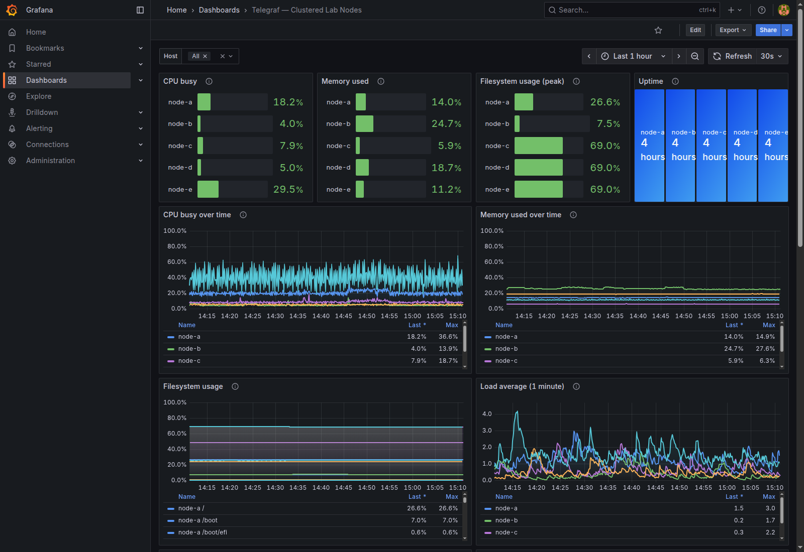
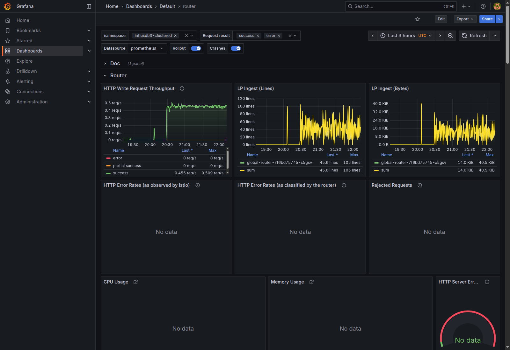

# Grafana, screenshots and Telegraf

Complete the SeaweedFS and Clustered guides first. Commands below assume the
namespace `influxdb3-clustered`, a working TLS Secret `clustered-gateway-tls`,
and valid registry access. Adjust names consistently if you change them.

## What this chapter adds

Grafana is the screen; Telegraf is the collector. They are separate programs.
First we make the database reachable from collector pods, then install the
authenticated Grafana view, then start collecting host measurements. The
bundled operational dashboards use Prometheus; the additional host dashboard
uses your InfluxDB `telegraf` database. See [Start here](start-here.md) for the
plain-English distinction.

## 0. Prepare access beyond the initial localhost test

The earlier Clustered chapter deliberately starts with a localhost certificate
and a temporary port-forward. That is enough for a workstation smoke test,
but **localhost inside a Telegraf pod means that pod, not your workstation**.
Do not reuse `https://localhost:8443` as the collector's destination.

This optional monitoring path follows the reference lab: use a reachable node's
IPv4 address, HTTPS NodePort 31443 for Clustered and 32443 for Grafana. No lab
DNS setup is required when using that IP. Both your workstation and the
collector pods must be able to reach it. Keep these ports firewalled to the
trusted lab; check for collisions before choosing them.

The following is a **state-changing access/certificate update**, not a command
to run against an existing installation without review. It briefly restarts
the gateway, not the database. It preserves localhost certificate access and
the old files for reference. The self-signed certificate expires in 30 days.

```bash
set -euo pipefail
umask 077
export LOCAL="$PWD/examples/clustered/.local"
test -f "$LOCAL/management.toml"
export INFLUXCTL_CONFIG="$LOCAL/management.toml"
export PATH="$LOCAL:$PATH"
python3 -m venv .venv
. .venv/bin/activate
python -m pip install -r requirements-dev.txt
mkdir -p .private .tools
chmod 700 .private
read -r -p 'Reachable lab node IPv4 address: ' NODE_IP
export NODE_IP
python3 -c 'import ipaddress, os; assert ipaddress.ip_address(os.environ["NODE_IP"]).version == 4'
export LAB_HOST="$NODE_IP"
export CLUSTERED_URL="https://${LAB_HOST}:31443"
export GRAFANA_URL="https://${LAB_HOST}:32443"
kubectl get services -A # inspect NodePort collisions; do not publish topology output
test ! -e .private/tls.key
test ! -e "$LOCAL/tls-localhost-original.crt"
cp "$LOCAL/tls.crt" "$LOCAL/tls-localhost-original.crt"
openssl req -x509 -newkey rsa:2048 -nodes -days 30 \
  -keyout .private/tls.key -out .private/tls.crt \
  -subj "/CN=${LAB_HOST}" \
  -addext "subjectAltName=IP:${NODE_IP},DNS:localhost,IP:127.0.0.1"
chmod 600 .private/tls.key .private/tls.crt
kubectl -n influxdb3-clustered create secret tls clustered-gateway-tls \
  --cert=.private/tls.crt --key=.private/tls.key \
  --dry-run=client -o yaml | kubectl apply -f - >/dev/null
cp .private/tls.crt "$LOCAL/tls.crt"
kubectl apply --dry-run=server -f examples/gateway/nodeport-service.yaml
kubectl apply -f examples/gateway/nodeport-service.yaml
kubectl -n influxdb3-clustered rollout restart deployment/clustered-gateway
kubectl -n influxdb3-clustered rollout status deployment/clustered-gateway --timeout=180s
curl --fail --silent --show-error --cacert .private/tls.crt "$CLUSTERED_URL/healthz"
```

The existing CLI profiles still use localhost and now trust the updated
certificate at the same `$LOCAL/tls.crt` path. Restart the original
`kubectl port-forward` if the gateway restart closed it. To use a real lab DNS
name instead, arrange resolution from both clients and pods, include that DNS
name in the certificate SAN, and set both URLs consistently. A workstation
`/etc/hosts` entry alone does not configure DNS for pods.

Do not reapply the original ClusterIP Service file without intending to remove
NodePort access. Keep the optional Service overlay in your later reapply flow.
If Grafana's gateway already exists when rotating its shared certificate, it
also needs a deliberate reload/restart; the new-install steps below create it
after the new certificate is ready. Do not rotate certificates as a routine
part of every monitoring update.

## 1. Understand Grafana ownership

The reference package includes operational dashboard definitions and an
experimental optional Grafana deployment. It does **not** bundle Telegraf.
The package used here does not accept arbitrary `components.grafana` or
`resources.grafana` overrides. Its default Grafana storage is ephemeral.

This guide renders the licensed package privately, selects only its Grafana
resources, then makes locally owned copies with authentication and persistent
storage. Keep `grafana` **off in the live Clustered feature flags** when using
this method: two controllers must not manage the same Deployment.

This is a lab customization, not an upstream-supported generic Grafana chart.
The public repository does not redistribute the nine package dashboards or
private package contents. You obtain them with your own registry entitlement.

## 2. Render the package privately

Use the `LAB_HOST` and URLs established in step 0. A certificate can cover the
same address/hostname on different HTTPS NodePorts.

```bash
set -euo pipefail
umask 077
: "${LAB_HOST:?Complete step 0 or supply your existing trusted LAN endpoint}"
export CLUSTERED_URL="https://${LAB_HOST}:31443"
export GRAFANA_URL="https://${LAB_HOST}:32443"
mkdir -p .private .tools
chmod 700 .private
curl --fail --location --silent --show-error \
  https://github.com/kubecfg/kubecfg/releases/download/v0.35.1/kubecfg_Linux_X64 \
  --output .tools/kubecfg
chmod 755 .tools/kubecfg
.tools/kubecfg version
export GRAFANA_RENDER_DIR="$(mktemp -d "$PWD/.private/grafana-render.XXXXXX")"
```

This download is specifically Linux x86-64. Select and verify an appropriate
upstream release asset on another workstation architecture. Verify its published
checksum through your usual software-supply-chain controls before use.

The following reads registry credentials directly into a private file; do not
turn on shell tracing or print that file. Adding a feature flag here modifies
only the local render input, not the live AppInstance.

```bash
python3 - <<'PY'
import base64, json, os, subprocess
from pathlib import Path
root = Path(os.environ['GRAFANA_RENDER_DIR'])
root.chmod(0o700)
def get(kind, name):
    return json.loads(subprocess.check_output([
        'kubectl', '-n', 'influxdb3-clustered', 'get', kind, name, '-o', 'json']))
a = get('appinstance', 'influxdb3-clustered')
package = a['spec']['package']
assert package['image'].endswith(':20261016-2070790'), 'Revalidate the generator for a different package'
flags = package['spec'].get('featureFlags', [])
assert 'grafana' not in flags, 'Resolve existing Grafana ownership before proceeding'
package['spec']['featureFlags'] = list(flags) + ['grafana']
registry = get('secret', 'gar-docker-secret')
for name, contents in {
    'appinstance.json': json.dumps(a).encode(),
    'config.json': base64.b64decode(registry['data']['.dockerconfigjson']),
}.items():
    path = root / name
    path.write_bytes(contents)
    path.chmod(0o600)
PY
DOCKER_CONFIG="$GRAFANA_RENDER_DIR" .tools/kubecfg show \
  oci://us-docker.pkg.dev/influxdb2-artifacts/clustered/influxdb:20261016-2070790 \
  --alpha --overlay-code-file "appInstance_=$GRAFANA_RENDER_DIR/appinstance.json" \
  --export-dir "$GRAFANA_RENDER_DIR/manifests" \
  --export-filename-format '{{.kind}}-{{.metadata.name}}'
python3 scripts/render_grafana.py \
  --manifest-dir "$GRAFANA_RENDER_DIR/manifests" \
  --public-url "$GRAFANA_URL" --output .private/grafana-bundled.yaml
```

Never `kubectl apply` the entire raw render directory. It contains the database
package, not just Grafana. The helper checks for exactly one Grafana Deployment
and nine local dashboard ConfigMaps. It keeps the bundled Prometheus datasource
UID stable, changes `emptyDir` to a PVC, sets a Recreate strategy for SQLite/RWO,
and applies only presentation changes to the dashboard definitions.

## 3. Generate private bootstrap credentials and install

For a **new** Grafana installation, generate credentials into ignored files.
Stop if you already have a `grafana-admin` Secret; preserve that identity rather
than rotate it during an upgrade.

```bash
if kubectl -n influxdb3-clustered get secret grafana-admin >/dev/null 2>&1; then
  printf 'Existing Grafana credentials found; preserve them and skip generation.\n'
else
  python3 - <<'PY'
import json, secrets
from pathlib import Path
import yaml
credentials = {'username': 'admin', 'password': secrets.token_urlsafe(32)}
for path, contents in [
    (Path('.private/grafana-admin.json'), json.dumps(credentials, indent=2)),
    (Path('.private/grafana-admin.yaml'), yaml.safe_dump({
        'apiVersion': 'v1', 'kind': 'Secret', 'type': 'Opaque',
        'metadata': {'name': 'grafana-admin', 'namespace': 'influxdb3-clustered'},
        'stringData': credentials})),
]:
    path.write_text(contents + '\n')
    path.chmod(0o600)
PY
  kubectl apply -f .private/grafana-admin.yaml
fi
kubectl -n influxdb3-clustered get secret grafana-admin -o name
kubectl apply --dry-run=server -f examples/grafana/access.yaml -f .private/grafana-bundled.yaml
kubectl apply -f examples/grafana/access.yaml -f .private/grafana-bundled.yaml
kubectl -n influxdb3-clustered rollout status deployment/grafana --timeout=180s
kubectl -n influxdb3-clustered rollout status deployment/grafana-gateway --timeout=180s
kubectl -n influxdb3-clustered get pvc grafana-data
curl --fail --silent --show-error --cacert .private/tls.crt "$GRAFANA_URL/api/health"
```

Open `$GRAFANA_URL`, trust the lab CA appropriately, and sign in using the private
bootstrap file in your own editor. Do not paste credentials into issue reports.
Anonymous access and self-signup are disabled. The nine operational dashboards
use the package's existing Prometheus Service; check datasource health and `up`
in Explore. Empty exporter-specific panels can be expected in this minimal lab.

The bootstrap Secret does not reset an existing password inside Grafana's SQLite
database. Never delete the Grafana PVC to repair a login or datasource issue.
Keep datasource UID `P1809F7CD0C75ACF3` if regenerating these resources.

## 4. Install Telegraf separately

Telegraf uses the v2-compatible write endpoint, with the database as `bucket` and
an empty `organization`. It does not use Flux or the standalone port 8181.

Create database `telegraf` through your management profile. Create **separate**
write-only collector and read-only dashboard tokens. The CLI prints new token
strings only once, so redirect responses to ignored private files. Here
`$INFLUXCTL_CONFIG` is the private management profile from the Clustered guide.

```bash
: "${INFLUXCTL_CONFIG:?Set the path to your private management profile}"
influxctl --config "$INFLUXCTL_CONFIG" database create telegraf
influxctl --config "$INFLUXCTL_CONFIG" token create --write-database telegraf \
  --format=json 'lab Telegraf collector' > .private/telegraf-write-token.json
influxctl --config "$INFLUXCTL_CONFIG" token create --read-database telegraf \
  --format=json 'lab Grafana read only' > .private/telegraf-read-token.json
chmod 600 .private/telegraf-*-token.json
kubectl create namespace telegraf --dry-run=client -o yaml | kubectl apply -f -
```

Do not blindly rerun database/token creation: inspect existing state and reuse
valid scoped identities. Token authorization may take several seconds to reach
all services. Open the token responses privately and put the **write** token in
`.private/telegraf-write-token` (only the token string, no JSON/newline). Put the
read token in your password manager for datasource configuration. Never use the
management bootstrap token as a collector token.

The collector Secret is created from a file without exposing the token as a
command-line argument. Ensure `$CLUSTERED_URL` resolves inside the Kubernetes
pods and its certificate is trusted by `.private/tls.crt`.

```bash
chmod 600 .private/telegraf-write-token
kubectl -n telegraf create secret generic telegraf-clustered-token \
  --from-file=INFLUX_TOKEN=.private/telegraf-write-token \
  --from-literal=INFLUX_URL="$CLUSTERED_URL" \
  --dry-run=client -o yaml | kubectl apply -f - >/dev/null
kubectl -n telegraf create configmap telegraf-clustered-ca \
  --from-file=tls.crt=.private/tls.crt --dry-run=client -o yaml | kubectl apply -f -
kubectl apply -f examples/telegraf/rbac.yaml
helm repo add influxdata https://helm.influxdata.com/
helm repo update influxdata
helm upgrade --install telegraf-ds influxdata/telegraf-ds --version 1.1.57 \
  --namespace telegraf -f examples/telegraf/values.yaml --wait --timeout 180s
kubectl -n telegraf get daemonset,pods -o wide
kubectl auth can-i get nodes --subresource=stats \
  --as=system:serviceaccount:telegraf:clustered-telegraf
kubectl auth can-i get nodes --subresource=pods \
  --as=system:serviceaccount:telegraf:clustered-telegraf
kubectl auth can-i get secrets -n telegraf \
  --as=system:serviceaccount:telegraf:clustered-telegraf
```

Expect the kubelet GET checks to return `yes` and Secret access `no`.
The supplied values scrape host CPU/memory/disk/network/system metrics, kubelet
stats, and Telegraf internal metrics. They mount `/run/udev` read-only for disk
identification, not the entire host `/dev` tree. Confirm this directory exists
on your nodes, and account for your Pod Security policy and control-plane taints.

Kubelet certificate verification is disabled **only for kubelet scraping** in
this lab example because those serving certificates were not trusted. This is a
security limitation, not a recommendation for production. Clustered output TLS
verification remains enabled. Prefer properly trusted kubelet certificates.

Verify logs on every collector and query recent metrics through your read-only
profile; a Running pod alone does not prove writes are authorized:

```sql
SELECT host, max(time) AS latest, count(*) AS points
FROM cpu
WHERE time > now() - INTERVAL '5 minutes' AND cpu = 'cpu-total'
GROUP BY host ORDER BY host
```

## 5. Add the importable Telegraf dashboard

In Grafana, add an **InfluxDB** datasource using the built-in plugin:

| Setting | Value |
|---|---|
| Query language | InfluxQL |
| URL | Your `$CLUSTERED_URL` (not the `/api/v2/write` URL) |
| Database | `telegraf` |
| HTTP method | GET |
| Custom header | `Authorization` |
| Custom header value | `Token <your read-only telegraf token>` |
| CA certificate | Contents of your lab CA certificate |
| Skip TLS verification | Off |
| Minimum interval | `10s` |

Use Grafana's secure credential fields for the token and CA. Save and test.
In **Dashboards → New → Import**, upload `dashboards/telegraf-nodes.json` and
choose this datasource when prompted. Do not select Prometheus for this import;
keep Prometheus as the default for the bundled operational dashboards.

The dashboard has sixteen panels covering node usage, uptime, load, physical
network/disk rates, kubelet usage and collector buffer/write behavior. Host is
multi-select and defaults to All. Counter charts use non-negative derivatives,
not raw cumulative counters. Peak filesystem usage is explicitly a range peak.
The public export uses Grafana's normal datasource import mapping and contains
neither datasource credentials nor captured metric data.

## Real screenshots and interpretation



Actual five-host CPU, memory, filesystem, uptime and trend panels. Visible host
labels were replaced with generic aliases in the browser before capture for
publication. Metric values, axes and queries were not changed; these are not
synthetic metrics. Different machines will naturally produce different values.



Actual router request/line/byte ingestion from the running lab. `No data` in
optional Istio/exporter panels is retained honestly. This screenshot is not a
claim that a service mesh or every optional metrics exporter was installed.

Both screenshots are 1600×1100 PNG browser viewport captures. They exclude the
browser address bar, tokens, private URLs and credentials. Original machine
names were not published. Views were inspected after real metrics rendered.

## Persistence and ongoing changes

- Dashboard-file changes belong in locally named `grafana-lab-dashboard-*`
  ConfigMaps and the render helper, not operator-owned originals or only SQLite.
- Mounted ConfigMaps update asynchronously; allow kubelet propagation plus the
  Grafana provider poll interval, then read back the exact dashboard UID.
- API/UI-created dashboards such as the imported Telegraf dashboard persist in
  Grafana's PVC. Keep the JSON export for clean-PVC recovery.
- A one-replica SQLite Grafana with a local PVC is not highly available or backed
  up by this recipe. A deployment restart interrupts Grafana; it should not
  erase credentials or dashboards.
- The locally managed Grafana is not automatically upgraded by Clustered Helm.
  Recheck image/security updates and render-schema compatibility deliberately.
